# EdgeDeck

A touch dashboard for the CORSAIR Xeneon Edge on macOS: live system stats, a
mirror of your macOS notifications, and Stream Deck–style launcher buttons.

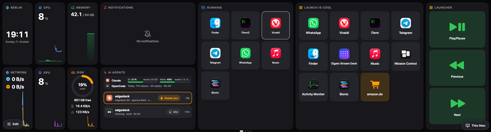

> [!IMPORTANT]
> EdgeDeck isn't signed with an Apple Developer ID or notarized, so **macOS blocks it the
> first time you open each version you download**. The warning only offers **Move to
> Trash** or **Done**: click **Done**, then go to System Settings → Privacy & Security,
> scroll down and click **Open Anyway** (see [Download](#download) for the steps, or the
> `xattr` shortcut).
> After every update you also need to grant its permissions again; see
> [Permissions](#permissions).

Tapping a notification clicks the real macOS banner (so Slack opens the right
conversation) and, for apps listed in `bringToEdgeOnTap`, brings that app's window to
the Edge as the Guest app. A strip on the right keeps **Activate** / **Send back** and your newest
notifications reachable while it's there.

## Permissions

EdgeDeck asks macOS for these in System Settings → Privacy & Security:

| Permission | Needed for | When |
| --- | --- | --- |
| **Accessibility** (called **Device Control and Data Access** on macOS 27) | Reading notifications, moving windows, key presses, and touch | Always |
| **Input Monitoring** | Touch, possibly on macOS 15 and earlier | Only if macOS asks; macOS 26 and 27 don't need it |
| **Calendar** | The Calendar Widget | If you use it |
| **Automation** (Music, and any app your AppleScript Buttons control) | The Music Widget and AppleScript Buttons | If you use them |
| **Local Network** | [Remote view](#another-macs-dashboard-remote-view) between your Macs | If you use it |
| **Screen Recording** | Remote view, on the Mac whose Dashboard is shown | If you use it |

Things that trip people up:

- **Touch needs Accessibility.** If your macOS also asks for Input Monitoring, allow it
  and then quit EdgeDeck from the menu bar and open it again: macOS applies that one only
  after a restart. Until then, macOS treats the touchscreen as a mouse, so taps on the Edge (even
  on EdgeDeck's own permission banner) may not do anything. Use the mouse on the menu bar
  icon or System Settings instead.
- **A switch can look on and still not work.** macOS ties permissions to the app's
  signature, and every release (or rebuild) has a new one. If EdgeDeck still asks after
  an update, select it in the list, remove it with **–**, then add
  `/Applications/EdgeDeck.app` back with **+**. Or reset it from Terminal and let
  EdgeDeck ask again:

  ```sh
  tccutil reset Accessibility com.arxcruz.edgedeck
  tccutil reset ListenEvent com.arxcruz.edgedeck
  ```

- **If you use EdgeDeck on two or more Macs** (Remote view, Grab the keyboard), macOS may
  ask for your password after an update: "EdgeDeck wants to use your confidential
  information stored in EdgeDeck Remote view" in your keychain. That's EdgeDeck reading its
  own Pairing secret for the other Mac, saved by the previous version; click **Always
  Allow**. EdgeDeck explains this before macOS asks (you can turn that off with "Don't show
  this again"), asks at most once per launch, and offers **Pair again** (with a new code,
  no password) if you'd rather not. With a single Mac you never see this. Like the permissions above, it's
  asked again after each update because the signature changes.
- The prompts and System Settings open on your main display, not on the Edge.

## About this project

EdgeDeck was vibe coded, and it's tailored to my own setup and needs. You're welcome
to use it, fork it, change it or take whatever you want from it; I don't mind.

The idea is to keep everything local, with no accounts or services. The only
exceptions are Weather, which uses the public [Open-Meteo](https://open-meteo.com) API
for forecasts and city search, and [Remote view](#another-macs-dashboard-remote-view),
which connects your own Macs to each other over the local network. Everything else
stays on the Mac.

EdgeDeck also has its own [touch handling](#touch) built in: it takes exclusive control
of the Edge's touchscreen, so if you use another touch driver or utility for the Edge,
the two will conflict. Only one can hold the touchscreen at a time. To keep your own
tool, turn EdgeDeck's touch off in **Settings → Touch**.

I haven't tested it extensively for memory leaks or for how much CPU it uses, so keep
an eye on it if that matters to you.

## Screenshots

All taken straight from the Edge (2560 × 720).

### Pages

**Main**: World Clock, CPU, GPU, Memory, Network, Disk, Notifications, AI Agents (a
Claude Code Session that Needs you and an OpenCode one), Running apps and two Launchers.


**Media**: Now Playing (here a YouTube video in the browser, with Watch on Edge) and Music.

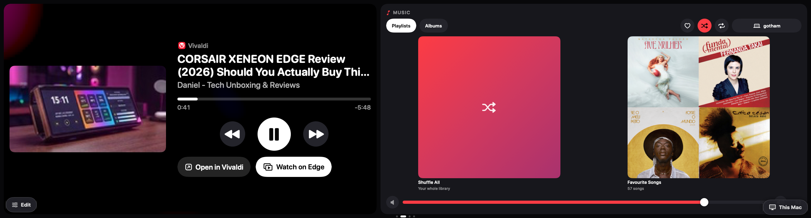

**World**: a World Clock with four Cities, day or night for each.

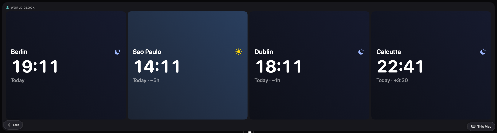

**Today**: two Weather Widgets (hourly strip and 7-day list) and Calendar.

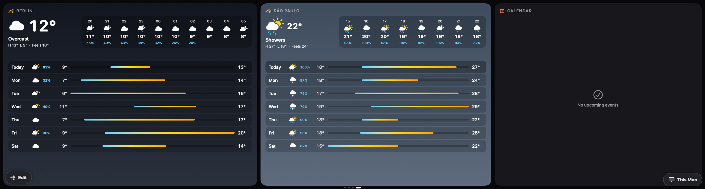

### Edit mode

Move, resize and remove Widgets, and add, reorder or delete Pages.

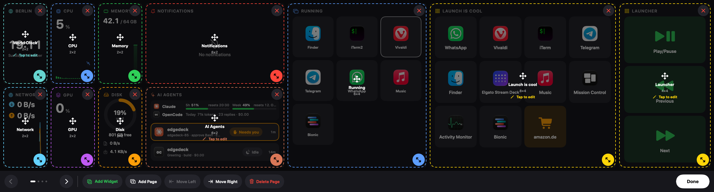

**Add Widget** lists every Widget kind.

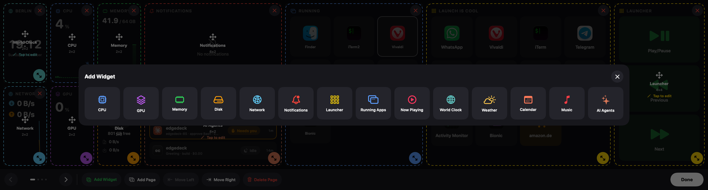

### Editors

Tap a Widget in Edit mode to configure it.

**Launcher editor**: the Buttons (drag to reorder, tap to edit), then apps, Running apps,
Controls and Shortcuts to add.

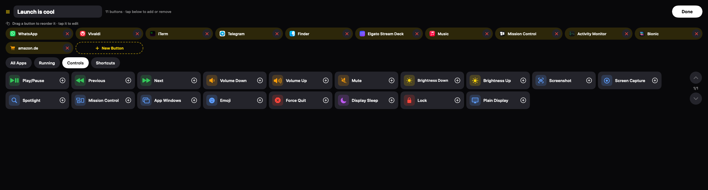
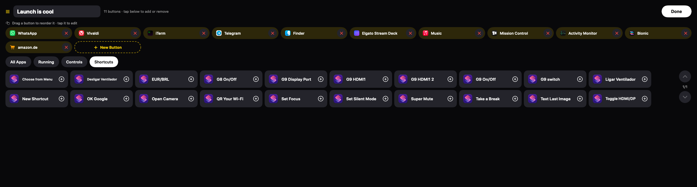
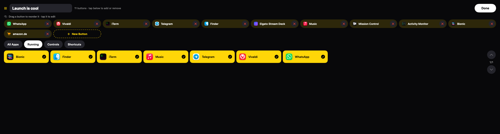

**Button**: its Action (App, URL, Shortcut, Keys, Shell, AppleScript, Plain Display),
title, colour and icon, with **Try** to test it.

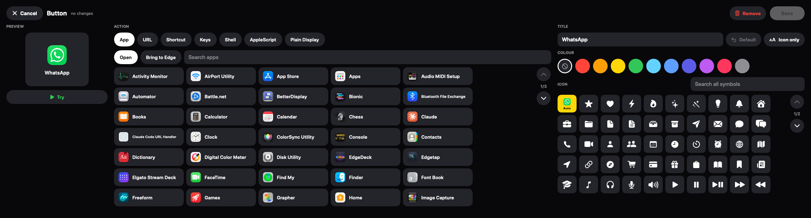

**World Clock Cities** and **Weather City**, by region, with Local for wherever the Mac is.

**Timer** and **Pomodoro**: the title, the Timer's chips or the Pomodoro's lengths and Rounds,
and the sound played when Ringing.

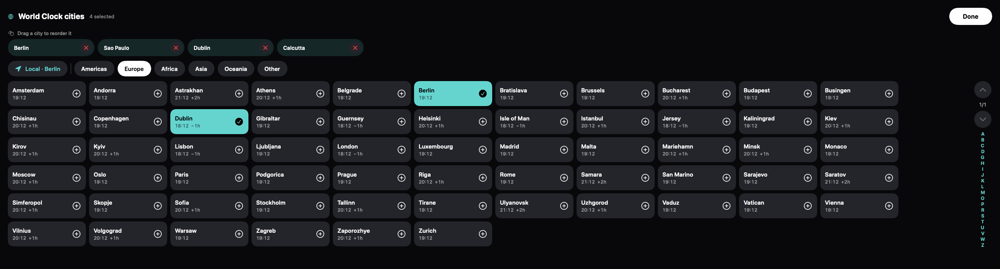
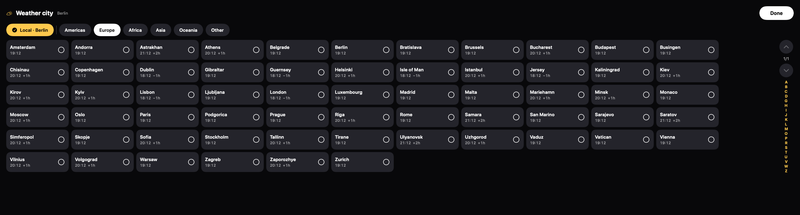

**Connect agents** (the AI Agents editor): Connect Claude Code Profiles and OpenCode,
Toast when a Session needs you, Show cost.

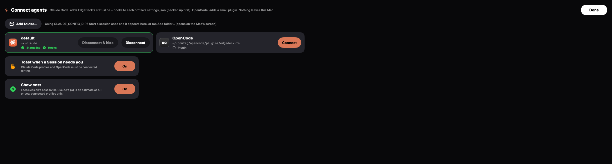

## Download

Get `EdgeDeck-<version>.dmg` from the [Releases](https://github.com/arxcruz/edgedeck/releases)
page, open it and drag **EdgeDeck** to **Applications**. What changed in each version is in
the [changelog](CHANGELOG.md). It runs on macOS 14 or later,
on Apple silicon and Intel Macs.

The release is **not notarized**. It's built by GitHub Actions and ad-hoc signed, with no
developer certificate, so macOS blocks it the first time. To open it:

1. Open **EdgeDeck** from Applications. macOS says it can't verify that EdgeDeck is free
   of malware, and offers only **Move to Trash** or **Done**. Click **Done** (not Move to
   Trash).
2. Open **System Settings → Privacy & Security** and scroll down to the **Security**
   section. It says "EdgeDeck" was blocked; click **Open Anyway**.
3. Enter your Mac's password (or use Touch ID) to confirm, then click **Open Anyway** once
   more if macOS asks.

The **Open Anyway** button only shows for about an hour after step 1, so if it isn't there,
open EdgeDeck again and go back. Right-click → Open no longer skips this since macOS 15.

Or skip all of that with one Terminal command after copying EdgeDeck to Applications:

```sh
xattr -dr com.apple.quarantine /Applications/EdgeDeck.app
```

You only do this once per version: that copy then opens normally. Every update is a new
download, so it needs allowing again.

Because the signature changes with every release, macOS also forgets EdgeDeck's
Accessibility and Input Monitoring permissions after each update; see
[Permissions](#permissions) for how to grant them again.

To make a release, add a `## <version>` section to [CHANGELOG.md](CHANGELOG.md), then push
a tag such as `v0.2.0`: the [Release workflow](.github/workflows/release.yml) builds the DMG
(`scripts/make-dmg.sh`) and attaches it to a GitHub Release, with that section as its notes. Running the workflow by
hand only uploads the DMG as a build artifact.

## Build & run

```sh
./scripts/build.sh
open /Applications/EdgeDeck.app
```

The build script installs the app to `/Applications` (`NO_INSTALL=1` skips that and
leaves only `build/EdgeDeck.app`).

On first launch macOS asks for **Accessibility** access (System Settings →
Privacy & Security → Accessibility, or **Device Control and Data Access** on macOS 27
→ EdgeDeck); see [Permissions](#permissions). It's needed to read
Notification Center, move windows and send key presses.

The build is ad-hoc signed, so macOS treats every rebuild as a new app and you
have to re-enable Accessibility after rebuilding. To avoid that, sign with a
stable identity: `SIGN_IDENTITY="Your Cert Name" ./scripts/build.sh`.

The menu bar icon has Edit Layout, **Use as Plain Display**, Reload Config, Send Back Guest App,
**Settings…** (⌘,) and Quit. **Settings** is an ordinary window on your main screen with
General (**Open at Login**, which works for the copy in `/Applications`, and config.json), Display
(which screen is the Edge, Rail width), Touch, Keyboard, Notifications (which apps come to the Edge
or are ignored, how many to keep, Toast time, how often to look); changes apply at once.

## Touch

Out of the box macOS treats the Edge's touchscreen as an absolute mouse: every touch
drags the cursor onto the Edge. EdgeDeck takes over the touchscreen instead (this used
to be the separate Edgetap app) and decides at touch-down where each touch goes:

- **On EdgeDeck itself** (the dashboard, the strip on the right, editors) touches go
  straight to it, without moving the cursor: buttons react the moment you touch them,
  a held finger shows as pressed and opens menus while it's still down, and in edit
  mode a drag moves a widget at once.
- **On any other window on the Edge** (a Guest app) touches become clicks, scrolls
  and drags:

| Touch | Result |
| --- | --- |
| Tap / double-tap | Click / double-click |
| Drag a finger | Scroll (content follows the finger); a flick keeps coasting, touch to stop |
| Rest ~0.5 s, then drag | Click-and-drag (move windows, select text) |
| Rest ~0.5 s, then lift | Right-click |

Touch needs Accessibility, and on some older macOS versions also **Input Monitoring**
(System Settings → Privacy & Security → Input Monitoring → EdgeDeck); EdgeDeck asks for
it only when macOS says it's missing, and a banner on the Edge says so until it's granted. **Settings → Touch** turns it on or off (off hands the
touchscreen back to macOS) and has scroll speed, reverse direction, momentum, flick
acceleration, the hold time and hiding the cursor. If the old Edgetap app is
running, EdgeDeck offers to quit it, since only one app can hold the touchscreen.

### Plain display

To use the Edge as a normal monitor, turn the dashboard off: **Use as Plain Display**
in the menu bar (⌘D while the menu is open), or a launcher button with the **Plain
Display** action (it's in the editor's Controls). Touch keeps working on whatever
windows you put there. **Swipe in from the Edge's right edge** to bring the dashboard
back (a small tab at that edge reminds you for a few seconds), or use the menu again.
EdgeDeck remembers it across restarts. While the Edge is a plain display, a session
that **Needs you** still pops its toast over your windows (notification toasts
don't), and bringing an app or video to the Edge turns the dashboard back on so the
strip with **Send back** is there.

The touchscreen reports a single finger, so there are no two-finger gestures. The
hardware notes and `touch-probe` (`swift run touch-probe [--seize]`, dumps the
controller's HID reports) came from Edgetap. `scripts/test.sh` runs the gesture
tests.

EdgeDeck only uses the Xeneon Edge. While it isn't connected, the menu bar icon
turns into a dashed rectangle, the menu says "Waiting for the Xeneon Edge…", and
**Show Preview** opens the dashboard in a window on the main display, at the Edge's
layout scaled to fit. Use it with the mouse to look around and edit. It closes when
the Edge is plugged in. Bringing an app to the Edge needs the real Edge.

## Another Mac's Dashboard (Remote view)

With EdgeDeck on a second Mac on the same network, the Edge can show **that Mac's
Dashboard** instead of this one's, and switch back, without moving any cables. The
Mac the Edge is plugged into is the **Host**; the Mac whose Dashboard is showing is the
**Source**. Either Mac can be either.

- Once another Mac is found, a pill at the Edge's bottom right names the Mac on show
  (**This Mac** at first). Tap it to choose another; the menu bar's **Show on Edge**
  does the same.
- The first time, the two Macs **Pair**: the Edge shows a 6-digit code and the Source
  asks for it. After that they remember each other (in each Mac's Keychain). Everything
  between them is encrypted.
- The Source needs the **Screen Recording** permission (it streams its own Dashboard,
  which it draws out of sight under the wallpaper) and both need **Local Network**.
  While it's being watched, the Source keeps its display awake.
- Touches act on the Source: Buttons, Now Playing and Notifications act on that Mac,
  and Edit mode edits its Dashboard. Only the Dashboard comes across: nothing can be
  brought to the Edge from a Remote view.
- Text fields in its Editors take either Mac's keyboard: this Mac's is forwarded while a
  field is in use (and handed back to your app afterwards), and the Source's own works
  too. Pasting uses the Source's clipboard.
- This Mac's Toasts still pop up over a Remote view. Bringing an app or video to the
  Edge, opening a Notification, or turning on Plain display goes back to this Mac's
  Dashboard, as does the Source going away (a message says so). EdgeDeck always
  starts on this Mac's Dashboard.

### Grab the keyboard

When the Edge is plugged into one Mac but your keyboard is on the other (say a KVM only
splits USB when each Mac has its own monitor), the Mac with the Edge can **grab the other
Mac's keyboard** while an app is on the Edge:

- Bring an app to the Edge. If another Mac running EdgeDeck is nearby **and Paired with
  this one as its Source**, the strip beside the app shows **Grab keyboard**. Pairing is
  per direction: if the button doesn't appear, Pair once from this Mac's Edge (the pill at
  the bottom right → choose the other Mac → type the code there).
- Tap it: the app comes to the front and everything typed on the other Mac's keyboard
  (⌘-shortcuts too) goes to it. The other Mac shows "Typing on …" at the top of its main
  screen and a keyboard icon in its menu bar; its mouse stays its own.
- **Release keyboard**, sending the app back, or another app replacing it gives the
  keyboard back. So does the other Mac on its own: its **Take Back Keyboard** shortcut
  (⌃⌥⌘K unless you change it), **Settings → Keyboard → Take Back Keyboard**, or losing
  touch with this Mac for two seconds.
- On the other Mac, **Settings → Keyboard** changes the shortcut (Record Shortcut) and
  can stop Paired Macs from grabbing the keyboard at all. It needs EdgeDeck's
  Accessibility permission there; while a password field is active on it, macOS hides the
  keys from every app and the strip says **Keyboard paused**.

`EDGEDECK_REMOTE_STATS=1` on the Source logs frames per second, encoding time and bit
rate. `EDGEDECK_REMOTE_NAME=<name>` renames a Mac on the network (for running a second
copy as a test Source on one Mac, with `EDGEDECK_NO_EDGE=1`), and
`EDGEDECK_REMOTE_SHOW=<name>` switches the Edge to that Source as soon as it's found.

## Pages & layout

The dashboard can have several pages. **Swipe left/right** anywhere on the Edge
to change page; dots at the bottom show which page you're on (hidden when
there's only one). Pages have no names. The menu bar macOS draws on the Edge is
always covered by a blank strip. Lists inside
widgets (notifications, launcher pages) use **vertical** swipes.

Swipes work both as drags (touch, mouse) and as scroll gestures (trackpads), which
EdgeDeck turns into page changes (the page follows the finger; momentum after
lifting is ignored, so one flick moves one page).

Each page is a grid (30 columns × 4 rows by default) and every widget has its
own position and size on it. Tap the slider icon (bottom-left of the Edge) to
edit:

- **Drag a widget** to move it, **drag its corner handle** to resize. The target
  cell turns green, or red if it would overlap another widget.
- **✕** removes a widget; **Add Widget** puts a new one in the first free spot.
- **Add Page**, **Move Left/Right** and **Delete Page** (tap twice to confirm)
  manage pages; ‹ › switch pages while editing.

Everything is saved to `~/Library/Application Support/EdgeDeck/config.json`,
which is also live-reloaded when you edit it by hand:

```json
"pages": [
  {
    "columns": 30,
    "rows": 4,
    "widgets": [
      { "type": "worldClock", "frame": { "x": 0, "y": 0, "w": 3, "h": 4 }, "cities": [{ "timeZone": "local" }] },
      { "type": "cpu",   "frame": { "x": 3, "y": 0, "w": 3, "h": 2 } },
      { "type": "gpu",   "frame": { "x": 3, "y": 2, "w": 3, "h": 2 } }
    ]
  }
]
```

Widget types: `cpu`, `gpu`, `temperature`, `fans`, `memory`, `disk`, `network`,
`notifications`, `launcher`, `runningApps`, `nowPlaying`, `worldClock`, `weather`,
`calendar`, `music`, `ai`, `timer`, `pomodoro`. Older `clock` widgets become a World Clock showing
the Local city, which looks the same. Older single-row configs are converted automatically (the original is kept
as `config.v1-backup.json`).

## Running apps

`runningApps` shows the apps currently open, with their Dock badges (unread
counts). Tap an app to bring it forward (it reopens a window if it has none);
long-press for **Bring to Edge**, **Hide** and **Quit**. The frontmost app is outlined
in white, the Guest app (on the Edge) in purple, and hidden apps are dimmed.

## Now Playing

`nowPlaying` shows whatever macOS lists as Now Playing (Music, Spotify, YouTube
in a browser, podcasts…): artwork, title, artist, source app and position, with
previous / play-pause / next. Tap the progress bar to seek, and the artwork or
app name to bring the source app forward. The layout adapts to the widget's
shape and size.

Below the controls, **Open in <app>** brings the source app forward and, for
browser media, **Watch on Edge** moves the video onto the Edge: EdgeDeck reads
the tab's URL (via Accessibility), pauses it in the browser and plays it
full-size on the Edge from the same second (YouTube through its official
embedded player, other sites by stretching the page's video). The strip on the
right then offers Play/Pause, **Back to <browser>** — which resumes the browser
at the point you reached — and Close. The video needs to be the active tab in
its browser window. The Edge player has its own web session, so you're not
signed in to YouTube there unless you sign in once inside it.

MediaRemote, the framework behind this, only answers Apple-signed processes on
recent macOS, so EdgeDeck runs a small helper (`Helpers/EdgeDeckMedia.m`,
bundled as `EdgeDeckMedia.dylib`) inside `/usr/bin/perl` and talks to it over a
pipe. If a future macOS closes that route, the widget says so instead of
showing stale data.

## World Clock

`worldClock` shows any number of cities as cards: local time (12/24-hour per
your macOS setting), a sun or moon for day/night, and how they relate to you
("Tomorrow · +7h"). The **Local** city always follows the Mac's current time
zone (marked **HERE**); every other city is fixed. With a single city the widget
is a desk clock: the time large with the full date. Cards re-flow to fill
the widget; when there are too many to stay readable they page (swipe up/down).
Add as many World Clock widgets as you like, on any page.

In edit mode, tap the widget to pick cities by touch: toggle **Local**, choose a region, page through
the cities (or jump with the A–Z index) and tap to add or remove. Selected
cities appear at the top, where you drag to reorder and ✕ removes one. In
`config.json` each city is `{ "timeZone": "America/Sao_Paulo", "label": "Office" }`,
where `label` is an optional custom name; `"timeZone": "local"` is the Local city.

## Weather

`weather` shows current conditions (temperature, condition, today's high/low,
feels-like), an hourly strip when the widget is wide enough, and a 7-day list
when it's 4 rows tall. Data comes from [Open-Meteo](https://open-meteo.com) (no
account or API key) and refreshes every 15 minutes and after the Mac wakes.
Behind it, an animated sky matches the current weather, iOS-style: sun glow
and rays or twinkling stars, drifting clouds, rain, snow, fog or lightning,
different by day and night. It only animates while its page is on screen (and
stays still with System Settings › Accessibility › Reduce motion).
Units follow your macOS region (°C/km/h, or °F/mph for US). Tap the current
conditions to open Apple Weather.

Each Weather widget forecasts one city, Local (the Mac's current time zone) by
default. In edit mode tap the widget to pick Local or any city by touch, the same
picker World Clock uses. A city is the same thing in both widgets: a time zone,
an optional label, and optional coordinates (otherwise looked up by name). For a
place that isn't in the time-zone list, set it in `config.json`:

```json
{ "type": "weather", "city": { "timeZone": "America/Sao_Paulo" } }
{ "type": "weather", "city": { "timeZone": "Europe/Berlin", "label": "Home", "latitude": 52.52, "longitude": 13.40 } }
```

The older `"location": { "name": … }` form still works: a name matching a
time-zone city becomes that city, any other place is looked up and gets its
time zone and coordinates from its first forecast.

## Calendar

`calendar` lists today's and upcoming events from every calendar set up in
macOS Calendar (iCloud, Google, Exchange…), coloured by calendar. The next or
current meeting is outlined and shows "In 12 min" / "Now · 20 min left".
Events with a Zoom, Google Meet, Teams or Webex link get a **Join** button;
tap an event to open it in Calendar. Cancelled and declined events are hidden.

The first time, tap **Allow Calendar Access** on the widget. Optional settings:

```json
{ "type": "calendar", "days": 2, "calendars": ["Work", "Family"] }
```

`days` is how many days to show starting today (1–7, default 2); `calendars`
limits it to those calendar names (all by default).

## Temperature & Fans

**Temperature** shows the hottest CPU and the hottest GPU sensor, with a graph of the last two
minutes, and the numbers turn orange from 70 °C and red from 90 °C. **Tap** it to turn the card over
between °C and °F; each Temperature widget remembers its own side (`"fahrenheit": true` in
config.json, Celsius when absent). **Fans** shows each fan's speed and its share of the fastest it
can go. Macs stop their fans when cool, so it says **Idle** then, and **No fans on this Mac** on a
MacBook Air.

Both read the Mac's sensor chip (SMC) directly, with no extra access to grant, and only while one of
them is on the current page. They are tested on Apple silicon; on a Mac whose sensors EdgeDeck can't
find, the widget says **Unavailable** rather than guessing.

## Timer & Pomodoro

`timer` counts down from one of its chips (1, 5, 10 and 25 min by default; up to six, chosen
in its Editor): tap a chip to start. Tap the time to pause or resume; **+1 min** adds a minute
while it runs, and **Reset** appears once it's paused. Tapping the time on a stopped Timer
starts its last length again. Each Timer runs one countdown, so add a Timer per thing you're
timing and give each a title ("Tea", "Laundry").

`pomodoro` takes you through Rounds of **Work** and **Break** (25 and 5 min by default; the
last Break of each Cycle of 4 Rounds is 15 min), with a dot per Round. Nothing starts on its
own: tap **Start Work**, and when a phase ends, one tap starts the next. Paused, it offers
**Skip** (to the next phase) and **Reset Cycle**.

When a countdown runs out, the widget is **Ringing**: it pulses, plays its sound three times
(Glass by default, at the Mac's volume, so a muted Mac stays silent), and a Toast lists
everything Ringing. Tap the widget or its row on the Toast to stop it (a Pomodoro starts its
next phase); ✕ on the Toast silences everything, but the widgets keep pulsing until tapped.
During a Takeover a button on the Rail stands in for the Toast. On a small widget (one row
tall) the chips show while it's stopped and the time while it counts.

Countdowns are kept by when they end, in `timers.json` beside `config.json`, so they keep
going across restarts and sleep (one that ran out meanwhile rings when EdgeDeck is back). In
`config.json`:

```json
{ "type": "timer", "title": "Tea", "presets": [3, 5], "sound": "Ping" }
{ "type": "pomodoro", "pomodoro": { "work": 25, "shortBreak": 5, "longBreak": 15, "rounds": 4 } }
```

`sound` is any sound in `/System/Library/Sounds` (without `.aiff`).

## Music

`music` is a touch remote for Apple Music (Music.app), made to sit next to Now
Playing. **Playlists** shows your playlists (with artwork, or a mosaic of their
first albums) plus **Shuffle All**; **Albums** shows every album in your library
with its cover. Tap a tile to play it; the playing playlist is outlined. The top
bar has ♥ (favourite the current song), shuffle, repeat (off → all → one) and the
output button, which opens **Play on**: tap a device (Mac, Apple TV, HomePod,
AirPods, TV…) to play only there, or ＋/− to add or drop speakers. The bottom
slider is Music's own volume.

Albums are played through a helper playlist named **EdgeDeck** (Music can't be
told to play an album directly), so it appears in Music's sidebar. The first
time, macOS asks to let EdgeDeck control Music; if you said no, the widget links
to System Settings › Privacy & Security › Automation. Music is never opened by
the widget unless you tap **Open Music**.

## AI Agents

`ai` shows your local AI coding agents live: every running **Claude Code** session
(in all profiles — `~/.claude` and any `~/.claude-*`, e.g. `.claude-work` /
`.claude-personal` used via `CLAUDE_CONFIG_DIR` aliases) and every **OpenCode**
session open in a terminal, each with its project, Claude profile or OpenCode
agent (build, plan…) and state — Thinking, the tool it's running (Bash, Edit…),
**Needs you** (waiting for a permission or an answer; outlined in orange),
Compacting, Error or Idle — and for how long. Tap a row to bring its
terminal forward. On top: each Claude profile's **5-hour and weekly plan limits**,
and OpenCode's tokens/replies today. **Show cost** (in the widget's editor, off by
default) adds each session's cost so far to its row — for Claude Code an estimate at
API prices (≈, connected profiles only), for OpenCode what it records — and today's
cost to OpenCode's row. Everything is read from files on this Mac.

Out of the box you get busy/idle (Claude Code's own session files) and OpenCode's
state from its local database. For plan usage and tool-level detail, tap
**Connect** on the widget (or tap the widget in edit mode) and **Connect** each
profile: EdgeDeck backs up its `settings.json`
(`settings.json.edgedeck-<time>.bak`), then adds hooks and wraps the statusline
through a small script (`~/Library/Application Support/EdgeDeck/bin/claude-bridge`)
that saves what Claude Code sends and runs your own statusline unchanged.
Running sessions pick up the hooks after a restart. **Disconnect** removes
exactly what was added and restores your statusline command.
**Connect** on the OpenCode card (OpenCode 2.x) adds one plugin,
`~/.config/opencode/plugins/edgedeck.ts`, which tells EdgeDeck when a session asks
for a permission or asks you a question; restart OpenCode to load it.
**Disconnect** deletes the file. OpenCode sessions are matched to the `opencode`
running in their folder, so with several open in one folder, **Go to session** may
pick the wrong tab unless they run `--standalone` with the plugin installed.
(`"ai": { "opencodeDatabase": "…" }` overrides OpenCode's database path.)

When a session **Needs you**, a Toast drops in on the Edge (whatever Page you're
on) with **Go to session**; it stays until the session moves on or you tap ✕.
**Bring to Edge** on the Toast moves that session's terminal tab (iTerm2 and Terminal;
other terminals: their front window) onto the Edge, and the strip on the right offers
**Yes / Always / No** — Claude Code's `1` / `2` / Esc, sent to that terminal only — so you
can answer without the Mac's keyboard or screen (handy when a KVM has them on another
Mac). Once it no longer needs you, the terminal goes back and the Edge returns to how it
was. While
a Guest app or the Edge player covers the Dashboard, an orange **Needs you** button
on the Rail stands in for it. Your terminal's own "needs your permission"
notification gets no second Toast. Turn it off in the widget's Connect view
(`"ai": { "toastOnNeedsYou": false }`). Claude Code profiles must be Connected.

### Several Claude Code profiles

Claude Code keeps everything (login, settings, history) in one config folder,
`~/.claude` by default. Setting `CLAUDE_CONFIG_DIR` points it at another one, so
you can keep separate profiles — e.g. work and personal accounts on one Mac:

```sh
# zsh / bash (~/.zshrc, ~/.bashrc)
alias claude-work='CLAUDE_CONFIG_DIR=~/.claude-work claude'
alias claude-personal='CLAUDE_CONFIG_DIR=~/.claude-personal claude'
```

```fish
# fish (~/.config/fish/config.fish)
alias claude-work 'CLAUDE_CONFIG_DIR=~/.claude-work claude'
alias claude-personal 'CLAUDE_CONFIG_DIR=~/.claude-personal claude'
```

EdgeDeck finds profiles on its own:

- `~/.claude`, `~/.claude-*` and `~/.claude_*`, once Claude Code has run there
  (a folder with only a copied `settings.json` doesn't count);
- any other folder, the first time a session runs with `CLAUDE_CONFIG_DIR`
  pointing at it (it's remembered in `config.json`);
- **Add folder…** in the widget's Connect view (opens the folder picker on the
  Mac's own screen).

Profiles are named after their folder: `~/.claude` is *default*, `~/.claude-work`
is *work*, `~/dev/acme/claude` is *acme*. Each one is Connected on its own. **Hide**
takes one off the list (Disconnecting it first); hidden ones can be shown again
from the same view. In `config.json`:

```json
"ai": {
  "claudeDirs": ["~/dev/acme/claude"],
  "hiddenClaudeDirs": ["~/.claude-old"]
}
```

`claudeDirs` adds folders to the ones found automatically; `hiddenClaudeDirs`
hides profiles.

## Launcher buttons

In edit mode (**Edit**, bottom-left), tap a launcher to edit it by touch
(an empty launcher also shows **+ Add apps** outside edit mode). Tap the title at the top
to rename the launcher (**Save** / **Cancel**; empty shows "Launcher"). The top row shows its buttons
in order (drag to reorder, ✕ to remove, tap one to edit it, **+ New Button** for a blank one); below, every installed app (from the
Applications folders, plus Finder) — tap one to add or remove it. **Running**
narrows the list to open apps; page with ⌃⌄ / swipes or jump with the A–Z index.
**Controls** offers ready-made buttons (play/pause, previous/next, volume, mute,
brightness, screenshot, Spotlight, Mission Control, emoji, force quit, display
sleep, lock), and **Shortcuts** lists your Shortcuts.app shortcuts. A Control is
only a template: once added it's an ordinary button you can change.

Editing a button sets its **Action** (an app to Open or Bring to Edge, a URL, a
shortcut, keys, a shell command or AppleScript), title, colour and icon. **Save**
keeps the changes (**Add to Launcher** for a new button), **Cancel** drops them. The title and
icon follow the Action until you choose your own; **Icon only** clears the title.
**Record** captures a key combo from the Mac's keyboard (type combos macOS keeps for
itself, like `cmd+space`, in the field instead). Text is typed on the Mac's keyboard:
tapping a field lets the Edge take keystrokes until you leave the button (or tap
**Stop**). **Try** runs the Action and shows a script's exit status and output. On the
dashboard, a button whose Action fails flashes red. Everything can also be set in
`config.json`:

```json
{
  "type": "launcher",
  "title": "Apps",
  "frame": { "x": 21, "y": 0, "w": 9, "h": 2 },
  "buttons": [
    { "title": "Slack", "action": { "type": "openApp", "value": "com.tinyspeck.slackmacgap" } },
    { "title": "Bring Slack", "symbol": "rectangle.portrait.and.arrow.right", "color": "#BF5AF2",
      "action": { "type": "bringToEdge", "value": "Slack" } },
    { "title": "Mute", "symbol": "speaker.slash.fill", "action": { "type": "keys", "value": "mute" } }
  ]
}
```

| `action.type` | `value` |
| --- | --- |
| `openApp` | bundle id, app name or path |
| `bringToEdge` | same as `openApp`; opens the app and brings its window to the Edge as the Guest app |
| `openURL` | any URL, including app schemes (`slack://`, `raycast://`, …) |
| `shell` | command, run with `zsh -lc` |
| `shortcut` | name of a Shortcuts.app shortcut |
| `appleScript` | AppleScript source |
| `keys` | shortcut like `cmd+shift+4`, or a media key: `playpause`, `next`, `previous`, `volumeup`, `volumedown`, `mute`, `brightnessup`, `brightnessdown` |

`symbol` is any SF Symbol name; without it the app's icon (or one matching the
Action) is shown. `color` tints the button (any hex in `config.json`; the editor
offers ten swatches). An empty `title` shows only the icon. Buttons whose app isn't installed are dimmed and marked "Not installed".

## Notifications

```json
"notifications": {
  "bringToEdgeOnTap": ["Slack"],
  "ignoreApps": [],
  "maxItems": 30,
  "toastSeconds": 8
}
```

Names are the app names shown on macOS banners. Notifications are read from the
banners macOS displays, so apps silenced by Focus/Do Not Disturb, or set to
"None" in System Settings → Notifications, won't appear. If a banner has already
disappeared when you tap it, EdgeDeck activates the app instead; setting Slack's
alert style to **Persistent** keeps banners around so taps always open the
exact conversation.

## Display

```json
"display": { "match": "XENEON", "railWidth": 150 }
```

`match` is a substring of the display name; `railWidth` is the width of the
Rail beside a Guest app or the Edge player. Older names (`dockOnTap`,
`dockRailWidth`, `dockApp`, `zones`, `location`) are still read. Without a match EdgeDeck waits for
the Edge (see Show Preview above) rather than taking over another display.

## Debugging

`EDGEDECK_SNAPSHOT=/tmp/edge.png build/EdgeDeck.app/Contents/MacOS/EdgeDeck`
writes a PNG of the dashboard every 3 seconds.
`EDGEDECK_NO_EDGE=1` behaves as if the Edge were unplugged; add
`EDGEDECK_SNAPSHOT_PREVIEW=1` to open the preview and save it as `<path>-preview.png`.
`EDGEDECK_CONFIG_DIR=<dir>` reads `config.json` and `timers.json` from another folder, so a
test run leaves your own untouched.

## Plans for the future

Ideas I may get to, in no particular order:

- **Vertical display**: support the Edge mounted upright (portrait), with the
  Dashboard, Pages and touch laid out for it.
- **Settings window**: a window on the Mac's main screen for the global settings that
  today live only in `config.json` (notifications, display, AI Profiles, …).
- **Calendar editor**: choose calendars and how many days to show from the Edge,
  instead of `config.json`.
- **City labels**: give World Clock Cities your own names from the City editor.
- **More AI agents**: other coding agents, such as Antigravity or Codex, in the AI
  Agents widget.
- **Now Playing**: a volume slider and ±15 s skip buttons.
- **Widget themes**: choose a background colour or theme for each Widget, in its Editor.
- **Analog faces**: show Timer, Pomodoro and World Clock as an analog dial instead of digits.

## License

MIT — see [LICENSE](LICENSE).
